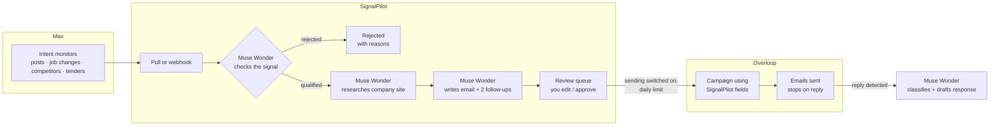
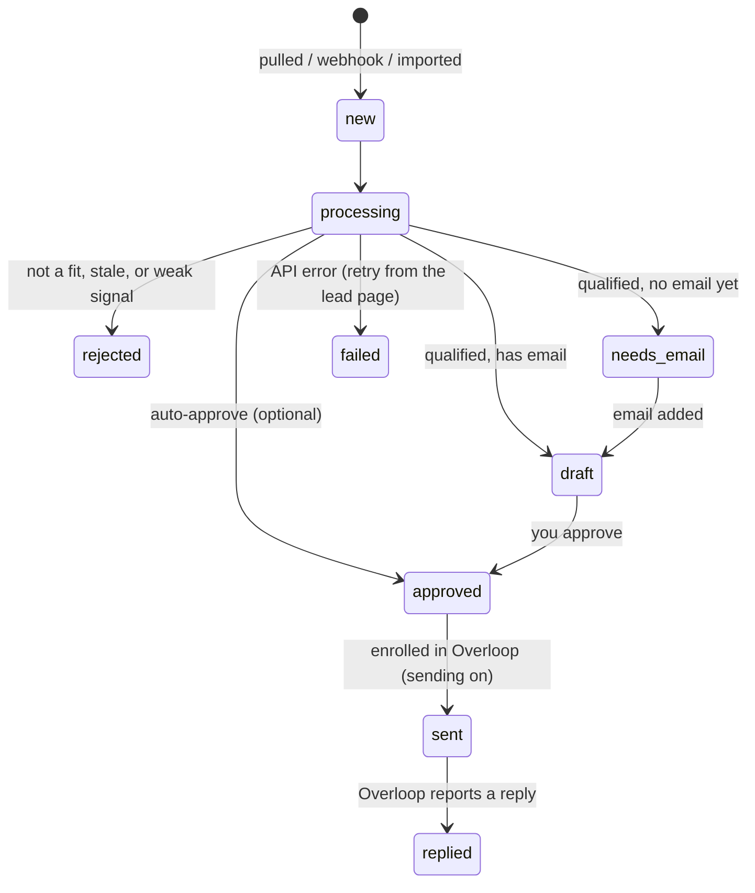

# SignalPilot

**An open-source email agent that acts on buying signals. Max finds them, Muse Wonder checks, researches and writes, and Overloop sends.**

SignalPilot runs on your own computer with your own accounts. It pulls leads that [Max](https://yourmax.ai) has flagged as showing buying intent. Meta's **Muse Wonder** model then decides whether each lead is really worth contacting, researches the company, and drafts an email backed by evidence. Approved emails go out through an [Overloop](https://overloop.com) campaign, within a daily limit.

Nothing is sent until you review the drafts and switch sending on.

---

## Contents
1. [Why it exists](#why-it-exists)
2. [How it works](#how-it-works)
3. [Features](#features)
4. [Quick start (5 minutes)](#quick-start)
5. [Connecting each tool](#connecting-each-tool)
6. [Daily workflow](#daily-workflow)
7. [The lead lifecycle](#the-lead-lifecycle)
8. [Safety](#safety)
9. [Costs](#costs)
10. [What a real run looks like](#what-a-real-run-looks-like)
11. [Troubleshooting](#troubleshooting)
12. [Configuration reference](#configuration-reference)
13. [Project structure and development](#project-structure-and-development)
14. [Roadmap](#roadmap)

---

## Why it exists

Cold email teams have more tools than ever and the same 3% reply rate. These are the problems SignalPilot was built to solve:

### 1. Most intent signals are noise
Intent tools flag thousands of companies as "researching". Very few of them are actually buying: one DemandScience analysis found that of 5,903 companies flagged as researching a category, only **62** were in-market. Most AI SDRs take that whole list and email everyone, just faster. That burns your domain, your credits and your brand.

**What SignalPilot does:** Muse Wonder scores every lead for ICP fit, signal strength and urgency, and **rejects the weak ones before anything is written**, with a plain-English reason. Your minimum fit score and maximum signal age are enforced in code, so a lenient model answer can't let a bad lead through. If the model's reasons don't match the lead's real data, the lead is held for a human.

### 2. Good signals go stale before anyone acts
The window between "researching" and "picked a vendor" can be just a couple of weeks. Most teams lose days to the handoff: someone exports from the signal tool, cleans the list, and uploads it to the sending tool on a busy afternoon.

**What SignalPilot does:** leads are pulled from Max every 30 minutes (or arrive by webhook in seconds), stale signals are dropped automatically, and approved emails go out **most urgent first**.

### 3. Personalization reads as fake
Buyers have seen "I noticed your company just raised a Series B" a thousand times. When the only personal detail is a scraped headline, the email is a mail merge with extra steps, and reply rates show it: Instantly's 2026 benchmark puts the average cold email reply rate at about **3.4%**.

**What SignalPilot does:** it reads the prospect's own website and writes a research brief in which **every fact has a quote and a source link**. The email is built only from that evidence. Generic openers ("hope this finds you well", "just checking in") and creepy ones ("you were flagged as a match") are caught in code and the draft is rewritten.

### 4. Reps research instead of selling
Salesforce's research puts the share of a seller's week spent actually selling at roughly **40%**. The rest goes to research, admin and switching between tools that don't talk to each other.

**What SignalPilot does:** the research, the brief and the first draft (email plus two follow-ups) are done before the rep opens the review queue. The rep reads, edits any line, and approves. Account memory means what was learned about a company is reused for the next lead from that company.

### 5. AI copy you can't control
Many AI writing tools give you a block of text you can't easily fix, and no idea why it says what it says.

**What SignalPilot does:** every line is editable, the evidence behind it is shown alongside, and nothing is sent until you approve it. Sending is switched off until you turn it on.

### 6. Deliverability and wasted credits
Sending to everyone on an intent list hurts your sending reputation, and enriching leads you'll never contact wastes credits.

**What SignalPilot does:** a daily send cap through your own Overloop setup, and rejected leads never reach enrichment. The dashboard shows how many false alarms were filtered out.

### At a glance

| Pain point in outbound today | What SignalPilot does about it |
|---|---|
| **Most intent signals are false alarms.** One DemandScience analysis found 62 of 5,903 "researching" companies were actually buying. | Muse Wonder scores **ICP fit, signal strength and urgency** for every lead. Your minimum fit score and maximum signal age are enforced in code. Weak leads are rejected, with a reason you can read. |
| **Signals go stale.** Buying windows can be 2–4 weeks long. | Leads are pulled every 30 minutes, or arrive by webhook in seconds. Stale signals are rejected, and the most urgent leads are sent first. |
| **Personalization reads as fake.** "Saw you raised a Series B…" | Emails are built only from facts quoted from the prospect's own website, with source links. Generic or creepy lines ("you were flagged as a match") are caught in code and rewritten. |
| **Wasted enrichment credits.** | Rejected leads never reach email enrichment. The dashboard shows how many false alarms were filtered out. |
| **AI copy you can't edit.** | Every line of every draft is editable in the review queue, and the evidence behind it is shown alongside. |
| **Deliverability.** | A daily send limit, with the most urgent leads first, sent through your own Overloop sending setup. |
| **Follow-ups that just "check in".** | Two follow-ups, each built on a different piece of evidence, plus memory of each account across leads. |

---

## How it works



1. **Max** watches for buying signals on your business's ideal customer profile (ICP).
2. **SignalPilot** pulls those leads every 30 minutes, or receives them by webhook.
3. **Muse Wonder checks the signal**: is this person a fit, and does the signal show a real, current need? Most leads stop here, which is the point.
4. For qualified leads it **researches** the company website (homepage plus about, news and careers pages) and writes a *why now* brief in which every fact is quoted with its source.
5. It **writes** an email and two follow-ups (around day 3 and day 7), each using a different piece of evidence.
6. **You review**: edit anything, approve, or reject.
7. When sending is on, approved leads are created as **Overloop prospects** with the copy in custom fields, and enrolled in your Overloop campaign. Overloop sends the emails and stops the sequence when someone replies.
8. **Replies:** SignalPilot sees that a prospect replied. Paste the reply in, and Muse Wonder classifies it and drafts your response.

---

## Features

- **Setup page** (`/setup`): connect Muse Wonder, Max and Overloop by pasting keys. Pick your Max business and Overloop campaign from dropdowns. Keys stay on your computer.
- **Getting-started checklist** on the dashboard, with a "Next step" button until you're fully set up.
- **Monitors page** (`/monitors`): see your Max signal monitors, when each last ran, and how many of its leads qualified. Create new monitors from four presets with editable keywords, or pause and resume them.
- **Pull from Max** every 30 minutes, or with one click. The webhook receiver is optional.
- **Signal checking** with scores, plain-English reasons, a stale-signal cutoff, a minimum fit score, and a check that the reasons actually describe this lead (with a retry if not).
- **Research briefs** grounded in the prospect's own website plus Max's company data, with every fact quoted and linked.
- **Email writer** with banned-phrase detection (generic openers, "just checking in", "you were flagged", "our ICP"…) and an automatic rewrite.
- **Review queue** with an editable subject, body and two follow-ups, plus approve, reject and re-run.
- **"Needs email" queue** for qualified leads that Max hasn't enriched with an email address yet.
- **Overloop sending** through your own campaign, with a daily limit and the most urgent leads first.
- **Reply tracking** plus reply classification and a drafted response.
- **Account memory**: everything learned about a company is reused for the next lead from that company.
- **Dashboard** showing signals → qualified → sent → replied, rejection reasons, sends left today, and Muse Wonder spend.
- **CSV export** of leads, with scores, reasons and drafts. Filter leads by status and by signal type.
- **Events log** of every webhook delivery and integration error, including raw payloads.
- **Safety:** sending is off by default, a typed confirmation turns it on, an optional UI password, and protection when fetching websites.

---

## Quick start

**You need:** Node.js **22.13 or newer** (it uses the built-in `node:sqlite`) and git.

```bash
git clone https://github.com/thoughtpilot99/muse-x-yourmax-x-overloop.git
cd muse-x-yourmax-x-overloop
npm install
npm run dev
```

Open **http://localhost:3000**. The dashboard shows a *Getting started* checklist. Click **Next** and follow it:

1. **Setup → Muse Wonder:** paste your Meta Model API key, then **Test**.
2. **Setup → Max:** paste your Max API key, then pick your business. Leave "Import its ICP" ticked.
3. **Settings:** check the imported ICP and write a sharp description of your offer.
4. **Monitors:** add at least one buying-signal monitor (start with *Agency search posts* or *New leaders*).
5. **Dashboard → Pull leads from Max**, then **Process new signals**.
6. **Review queue:** read the drafts. This is the moment to tune your offer text and tone.
7. **Setup → Overloop:** paste the key, do the one-time campaign setup, then pick the campaign.
8. **Setup → Go live:** type `SEND` to turn sending on, but only when you're happy with the drafts.

To run it for real use rather than development, run `npm run build && npm start`.

---

## Connecting each tool

### 1. Muse Wonder (required)
- Create a key at **[dev.meta.ai](https://dev.meta.ai) → API keys**.
- Default model: `muse-wonder-1.0` (preview), through Meta's OpenAI-compatible endpoint `https://api.meta.ai/v1`.
- You can change the model or endpoint with `MUSE_MODEL` / `MUSE_BASE_URL`.

### 2. Max (where leads come from)
- Get your API key from your Max account. If you use the Max command-line tool, `MAX_API_KEY` is the same key.
- On **Setup**, pick the **business** whose leads you want to work. Max scores leads against that business's ICP.
- **Monitors:** Max's built-in "ICP matches" feed only finds people whose profile fits, with no sign they're buying, so SignalPilot rejects most of those leads by design. Add intent monitors on the **Monitors** page:

| Preset | Max signal | Good for |
|---|---|---|
| Agency search posts | `social-mentions` | People posting that they're looking for a provider (edit the keywords to match your category) |
| New leaders | `job-changes` | People who just started a role matching your ICP titles |
| Competitor audience | `competitor-social-reactions` | Posts that your competitors' go-to-market teams engage with |
| Public tenders | `public-tenders` | Public bodies publishing tenders that match your keywords |

  Monitors created here never deliver leads to Overloop automatically: leads wait in Max until SignalPilot pulls and checks them. Max charges credits for the leads monitors find, so pause the ones you don't need.
- **Webhooks (optional):** instead of pulling, Max can push leads to `https://<tunnel>/api/webhooks/max`. Set a webhook secret on Setup and use the same value with `max webhooks:create --secret …`. See [Safety](#safety) before exposing the app.

### 3. Overloop (how emails are sent)
API access needs the **Growth plan** or higher. Overloop's API has no "send this email" call, so SignalPilot writes your copy into prospect custom fields, and your campaign uses those fields as merge tags.

One-time setup inside Overloop:
1. Create four **custom prospect fields**. SignalPilot expects the identifiers `c_sp_subject`, `c_sp_body`, `c_sp_followup1` and `c_sp_followup2`. If Overloop assigns different identifiers, enter yours under **Settings → Overloop custom fields**.
2. Create an **email campaign**:

   | Step | When | Subject | Body |
   |---|---|---|---|
   | 1 | Day 0 | `{{c_sp_subject}}` | `{{c_sp_body}}` |
   | 2 | Day 3, same thread | (reply) | `{{c_sp_followup1}}` |
   | 3 | Day 7, same thread | (reply) | `{{c_sp_followup2}}` |

   Exit trigger: **prospect replied**.
3. On **Setup → Overloop**, paste the key and choose the campaign from the dropdown.

---

## Daily workflow

1. **Morning:** open the dashboard. New signals have already been pulled and processed (every 30 minutes and every minute, respectively).
2. **Review queue:** read each draft next to its evidence. Fix anything that sounds off, then **Save and approve** or **Reject**.
3. **Needs email:** qualified leads without an address. Enrich them in Max, then paste the email on the lead's page.
4. Approved emails go to Overloop every 5 minutes, most urgent first, within the daily limit.
5. **Replies:** SignalPilot checks Overloop every 15 minutes. Paste a reply into the lead's page to get it classified and a response drafted, then answer from your Overloop inbox.
6. **Weekly:** use **Monitors** to see which signal types produce qualified leads. Pause the ones that don't, and tune their keywords.

Every automatic job also has a **Run now** button. Set `SP_JOBS_ENABLED=0` to make everything manual.

---

## The lead lifecycle



| Status | Meaning | What moves it |
|---|---|---|
| `new` | Just arrived | The processing job (every minute) or **Process new signals** |
| `rejected` | Not worth contacting | You can re-run it from the lead page |
| `needs_email` | Qualified, but no email address | Paste an email address |
| `draft` | Waiting for your review | **Save and approve** |
| `approved` | Will be sent | The send job, once sending is on, within the daily limit |
| `sent` | Enrolled in your Overloop campaign | Overloop sends the steps |
| `replied` | The prospect answered | Paste the reply to classify it and draft a response |
| `failed` | An API error | **Re-run Muse Wonder** on the lead page |

---

## Safety

- **Sending is off by default.** Until you type `SEND` on Setup, nothing is created in Overloop and no email is sent. `SP_SENDING_ENABLED=0` in `.env.local` forces it off regardless.
- **Auto-approve is off by default.** When it's on, only drafts above your score threshold with no banned phrases skip review.
- **Your keys stay local**, in `data/app.db` (gitignored). See [SECURITY.md](SECURITY.md).
- **Webhooks need a public URL**, for example `cloudflared tunnel --url http://localhost:3000`. A tunnel exposes the whole UI, so **set `APP_PASSWORD` first**. Every page except the webhook then asks for it.
- Prospect websites are fetched with private and internal addresses blocked, and every piece of lead data is treated as untrusted input by the model.

---

## Costs

| Item | Cost |
|---|---|
| SignalPilot | Free (MIT) |
| Muse Wonder | $4 per million input tokens, $20 per million output tokens ($0.20 per million for cached input). It's a reasoning model. In our test run, checking a lead cost about **$0.03–0.05**, and a full check + research + email about **$0.10–0.20**. Rejected leads stop after the first step. The dashboard shows your running spend. |
| Max | Your Max plan's credits (leads found by monitors, and enrichment). |
| Overloop | Your Overloop plan (API access needs the Growth plan or higher). |

---

## What a real run looks like

We pointed SignalPilot at Sortlist's own Max business with **sending switched off**, and processed 14 real leads.

- **All 14 were rejected, each with a readable reason.** Ten came from the plain "ICP matches" feed (people whose profile fits, with no sign of need). Four came from a job-change monitor (CEOs of Finnish IT and energy companies, not marketing buyers).
- The test exposed a made-up reason (the model described a different person). That led to the check that reasons must refer to the lead's own company, title, location or industry, with a retry, or else the lead is held for manual review.
- A forced research and writing run on one lead produced a brief with 8 quoted, linked facts from the company's site. The first draft said the prospect's role "was flagged as a match", which is now a banned phrase, caught in code.
- Total Muse Wonder spend for the run was about $1.

The lesson: point SignalPilot at **intent** monitors, and expect it to say no most of the time.

---

## Troubleshooting

| Symptom | Fix |
|---|---|
| Banner says "Not connected yet" | Connect Muse Wonder on **Setup**. |
| Overloop "Your API key is wrong" (401) | Create a new key in Overloop. Check that your plan includes API access. |
| Overloop 422 when sending | The custom field identifiers don't match. Compare **Settings → Overloop custom fields** with your fields in Overloop. |
| Max monitor shows "not yet" | Max runs monitors on its own schedule, usually daily. Check again tomorrow. |
| Everything gets rejected | Expected for "ICP matches" leads. Add intent monitors. Also check that your **offer** says who buys it. |
| A lead shows `failed` with "Connection error." | A temporary API error. Click **Re-run Muse Wonder**. |
| A webhook returns 503 | No webhook secret is set. Set one on **Setup**. |
| A webhook returns 401 | The signature doesn't match. The Events page shows the headers Max sent. |
| Website research fails | Some sites block bots or need JavaScript. SignalPilot falls back to Max's company data. |

---

## Configuration reference

Everything below can be set on the **Setup** or **Settings** pages. Environment variables in `.env.local` override what's set in the app. See [.env.example](.env.example).

| Variable | Purpose |
|---|---|
| `MODEL_API_KEY` | Muse Wonder (Meta Model API) key |
| `MAX_API_KEY`, `MAX_BUSINESS_ID` | Max API key and the business to work on |
| `MAX_WEBHOOK_SECRET` | Secret used to verify Max webhooks (optional) |
| `OVERLOOP_API_KEY`, `OVERLOOP_CAMPAIGN_ID` | Overloop key and sending campaign |
| `SP_SENDING_ENABLED` | Empty = controlled from Setup · `0` = force off · `1` = force on |
| `APP_PASSWORD` | Password for the whole UI (set it before using a tunnel) |
| `SP_JOBS_ENABLED` | `0` turns off background jobs |
| `MUSE_MODEL`, `MUSE_BASE_URL` | Model and endpoint overrides |

**Settings page:** ICP, offer, sender name, tone, maximum signal age, minimum fit score, daily send limit, auto-approve threshold, Overloop custom field identifiers.

---

## Project structure and development

```
app/
  setup/            Connect page + its server actions
  monitors/         Max monitor management
  leads/            Leads list, lead detail, CSV export
  replies/ events/ settings/
  api/webhooks/max  Max webhook receiver
lib/
  agents.ts         Muse Wonder steps: validate, research brief, write, reply triage, banned phrases, grounding check
  pipeline.ts       Lead lifecycle: pull/ingest, process, approve, send, poll replies, account memory
  maxApi.ts         Max REST client (leads, businesses, monitors)
  max.ts            Max payload normalizer + webhook signature check
  overloop.ts       Overloop JSON:API client
  research.ts       Company website fetcher (blocks private addresses)
  muse.ts           Muse Wonder client, structured outputs, cost logging
  config.ts         Settings from .env.local or the Setup page; send switch
  secrets.ts        Locally stored keys
  monitors.ts       Monitor presets
  jobs.ts           Background jobs
data/app.db         Local SQLite database (gitignored)
```

```bash
npm test            # vitest: integrations against mocked APIs, agent rules, pipeline, setup/switches
npx tsc --noEmit
npm run lint
npm run build
```

CI (`.github/workflows/ci.yml`) runs lint, type check, tests and build on every push.

---

## Roadmap
- Read Overloop reply text automatically (today you paste it in)
- Multi-user mode with login, and a hosted database option
- Run research on several leads at once
- A/B testing of email angles

## License
MIT. See [LICENSE](LICENSE).
